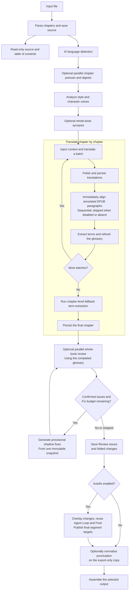
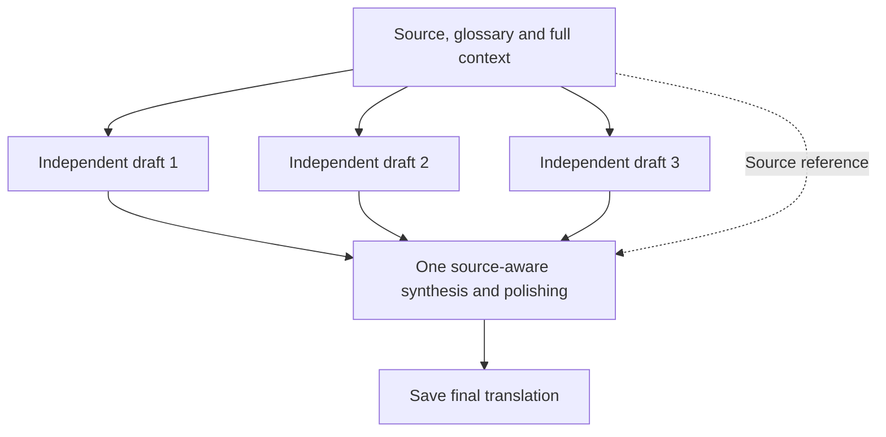
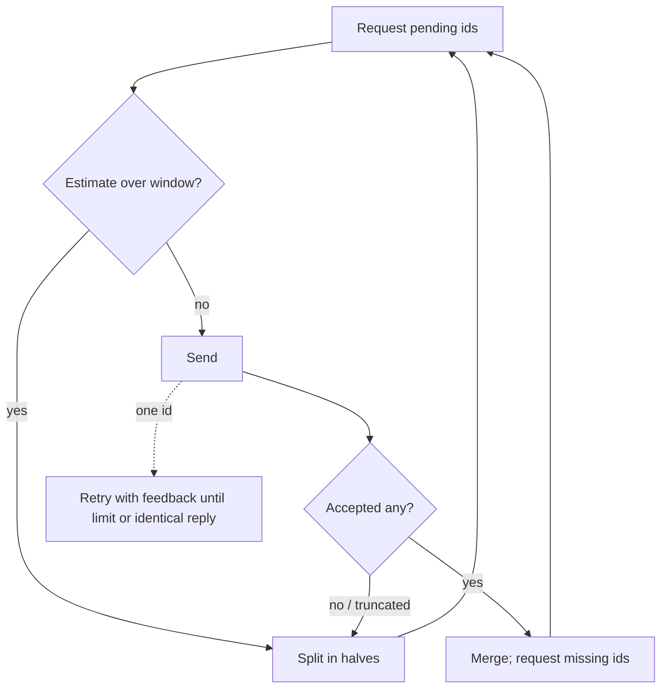
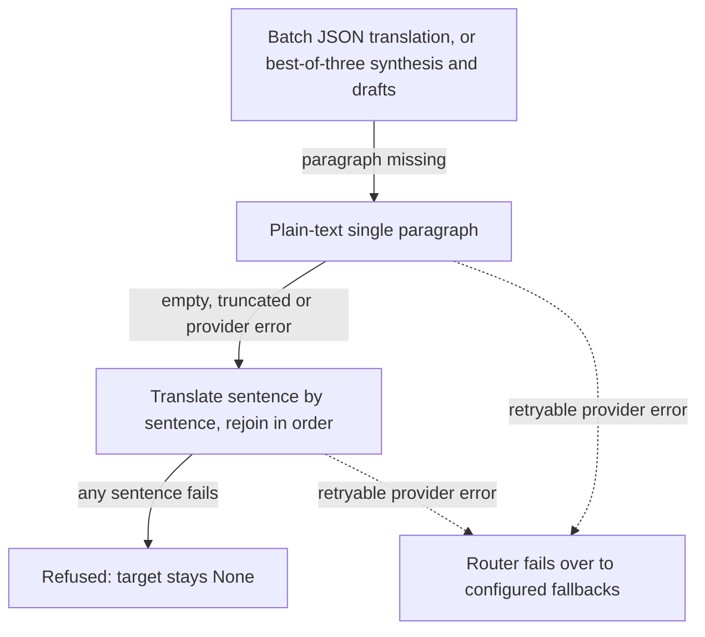

# Translation pipeline

[简体中文](zh/pipeline.md)

Wenyi first builds a whole-book understanding and then translates chapters in order. Optional stages can be disabled in `config.yaml` to reduce cost or runtime.

Source parsing is a separate, model-free stage. `wenyi parse` and the Web/Desktop upload task save a content- and configuration-bound source snapshot before AI preparation. The UI can show its table of contents and original paragraphs read-only immediately after parsing, including while preparation runs or after it fails. Parsing does not commit an initialized manifest, expose partially staged targets, or enable translation editing. Matching source snapshots survive initialization retries; changed source identities are not reused.



When `book_understanding` is enabled, chapter digests are generated in parallel before style analysis; the whole-book synopsis follows style analysis. In every mode, each digest covers the complete chapter through source chunks of at most 8,000 characters, merged in source order. Style analysis receives all chapter digests for facts and character context, while original opening/middle/ending samples remain the primary evidence for prose style. The synopsis uses the style brief, chapter digests, and relevant authoritative glossary mappings without full term notes. This preparation is independent of `terminology_context` and does not extract or seed glossary entries. The initialization manifest commits last, after chapter digests and style analysis. Disabling `book_understanding` skips both chapter digests and the book synopsis. During translation, each batch receives the most recent glossary snapshot and translated context to support cross-chapter consistency.

With `book_understanding` enabled, every chapter containing source text must have a usable digest before body translation starts. Truncated summary responses are retried by the shared provider retry policy, respecting `max_retries`, cancellation and invocation budgets. If a chapter digest still fails, preparation stops with the affected chapter indices. Successful complete-chapter digests and style analysis are cached before the manifest commits. Same-source initialization retries reuse these results and preserve cumulative usage, including recovery of pending usage commits, through File, SQLite, and PostgreSQL storage. Individual chunks of an unfinished chapter are not checkpointed. Empty chapters do not need digests. A failure to synthesize the whole-book synopsis logs a warning and allows translation to continue using the chapter digests. A failed group in a long book's synopsis merge invalidates the entire synopsis rather than omitting that group's chapters.

Neither `synopsis.chapter` nor `synopsis.book` adds an output-token cap. Without an explicit model `max_output_tokens`, requests use the service's default output limit. Requested digest and synopsis lengths remain unchanged. Removing the implicit cap avoids artificially limiting thinking-token headroom, but can increase reasoning-token costs and does not prevent truncation at the service's own limit. All modes require a completion marker and v2 digest cache identity bound to the chapter source hash, policy fingerprint, and model routing. Earlier sampled digests are regenerated once under the new rules; completed translations and glossary entries are preserved. A failed source-chunk or group synthesis does not publish a partial digest. Book synopsis caches bind their consumed inputs; failed regeneration preserves existing analysis but does not inject a stale synopsis into translation. Full-source coverage increases initial prescan cost for long chapters compared with the former sampled default; it avoids omitting later chapter facts, but offline tests do not establish model-quality gains.

The Review Fixer receives the same style brief, book synopsis, chapter digest,
relevant glossary subset, and nearby source/translation context used to preserve
the book's voice. Its normal Review-loop replacements remain temporary; the
optional Autofix publisher can later reuse it to produce formal segment targets.

## Language rules and state scope

Source and target are independent choices. Body translation, titles, term renderings and notes, analysis descriptions, polishing, chapter digests, and book synopses are requested in the target language. In every mode, digests and synopses retain source-language character identities rather than independently inventing translated names; existing authoritative mappings guide interpretation, while the live glossary owns character-name mappings. `source` and `aliases` retain their original spelling. Task instructions use English and live in `packages/core/wenyi_core/i18n/data/tasks/`; source understanding, target expression, pair-specific honorific rules, and metadata language constraints live alongside them in `languages/`, `pairs/`, and `shared/`. JSON keys and stable identities remain unchanged. Glossary type/gender values use English identifiers; older Chinese enum values are no longer converted. Analysis also accepts a model's list of style-guide bullets without discarding it. Matching policies reuse saved analysis; changed built-in semantic revisions automatically rebuild affected analysis while retaining glossary notes.

All targets, including `zh`, own separate state under `state/<book>/targets/<target-language>/`. Each invocation freezes separate analysis, translation and Review plans using only the consumed templates and rules. Immutable `language-policies/<fingerprint>.json` artifacts and a phase checkpoint are persisted through Storage before initialization commits the manifest. Review cache identity includes its effective plan alongside model/content/glossary identities. Completed targets stay saved; changed built-in semantic plans or missing identities automatically rebuild affected analysis before pending model work. Task-specific fingerprints let unchanged chapter digests and style analysis reuse their caches. Interrupted rebuilds resume without prematurely committing the new checkpoint. Export-only changes compile a fresh plan without invalidating paid translation. See [built-in language policies](configuration.md#built-in-language-policies).

The pure `i18n/policy/` resolver separates source and target bindings, exact pair bindings defined in source. Domain adapters execute the registered punctuation, DOCX font, Japanese source-ruby and metadata capabilities against the consistent export snapshot. Text normalization operates over a complete logical paragraph and maps it back to stable segment boundaries; annotation/style offsets are remapped once. Pending `None`, intentionally empty targets and untranslated source fallbacks keep their identities. The complete export view is validated before opening the output, so a text-handler failure cannot replace an existing artifact. Manifest-last initialization, atomic writes, domain locks and Review/Autofix publication boundaries remain in place.

## Whole-book understanding and context

The prescan creates a digest for each chapter and a synopsis of the complete book. For every translation batch, the prompt presents stable information first: style guidance, the whole-book synopsis, the current chapter digest, the glossary entries cited by the batch, any source-language notes referenced by the current segments, recent translated context, the source text to translate, and one following source segment. Recent translation therefore remains immediately adjacent to the new source passage.

This lets early chapters benefit from knowledge of later events while helping adjacent batches preserve pronouns, forms of address, tone, and sentences that span multiple source segments.

Preceding translations use `pipeline.rolling_context_tokens` (default `512` tiktoken `cl100k_base` tokens, including newlines), not a fixed paragraph count. Read formal targets backward from the current batch, including preceding chapters as needed, and stop at the first pending target or paragraph that would exceed the budget. Blank completed targets are skipped. Keep complete paragraphs where possible; if the newest nonempty paragraph alone is oversized, use only its Unicode-safe tail. Alignment changes to earlier targets are immediately visible to the next batch. Fresh runs and resume use the same chapter-derived selection, with no separate rolling-context file or database field written or read; old caches remain untouched. Compared with six paragraphs, short dialogue may include more paragraphs and long paragraphs less history; offline token checks do not establish translation quality or actual provider savings.

The following segment is a quoted, read-only reference selected in whole-book source order, crossing chapter boundaries and skipping empty chapters as needed. It helps the translator recognize a sentence or dialogue that continues beyond the batch, including fragments split from a long paragraph, and avoid inventing an ending or forcing final punctuation. The reference is excluded from the numbered inputs and output count; its content must not be translated early or borrowed to complete the current paragraph. It is also supplied to polishing. Only the end of the book leaves no following reference. This is built in and remains enabled when `rolling_context_tokens` is zero, which disables only preceding translations.

Alignment retries retain the reference. Single-paragraph fallback uses that paragraph's immediate source neighbor, including an unchanged number or symbol. Resume recomputes the neighbor from source order after splitting completed and pending batches, preserving completed targets and stable segment identities. Lookahead is never added to the preceding-translation window. It adds at most one source segment to each translation or polishing request, with no extra model call. This supplies continuity evidence; actual wording and sentence endings still depend on the model.

### BabelDOC layout-aware continuity

BabelDOC PDFs use a separate continuity policy within the same translation workflow.
Only `plain text` units in a prose section can supply recent translations or the
following source reference. Headings bound sections rather than becoming preceding
prose. Both preceding and following context can cross chapter boundaries, including
empty or layout-only chapters, but still stop at explicit headings. Lookahead skips
intervening page decorations, tables, captions and other non-prose units. These
excluded units do not evict preceding prose from the recent-context window.

Contiguous layout roles and sections are batched separately before applying token
budgets and completed/pending boundaries. Non-prose batches receive no rolling prose
context, external following-prose reference, book synopsis or chapter digest. The same
batch plan supplies standard translation, alignment recovery, polishing and
best-of-three translation. All source units remain available for translation and
fillback, with their original order, indices and `babeldoc_id`; exclusion from context
does not mean deletion or automatic source passthrough.

The policy recognizes common English/Chinese reference and publication-information
headings. When an explicit abstract heading occurs in the first chapter, earlier
author/front-matter text is excluded from prose context. Actual heading positions
take precedence over page-based TOC chapter titles, so prose ending above a References
heading on the same page remains prose. Unknown labels, including `fallback_line`,
are conservatively excluded from prose context, not assumed to be structured table
cells. Unrecognized metadata and incorrect layout labels remain classification limits.

Each BabelDOC batch rebuilds its recent context from consumed formal targets in book
order, also on resume and chapter-only runs; legacy saved context strings are not reused.
Completed targets, including already saved empty strings, are preserved. Older
glossary checkpoints covering a newly split completed batch remain reusable without
repeating that batch's extraction. This first phase does not change prescan/style
sampling, glossary evidence, Review context, table row/column reconstruction or
page-decoration translation policy. Smaller isolated batches can increase model-call
overhead, and conservative selection can omit useful context after a layout
misclassification. Offline tests do not establish a model-quality improvement.

## Glossary

Preparation analyzes style and character voices without proposing name translations or extracting glossary entries. As translation proceeds, Wenyi extracts and updates people, places, organizations, terms, techniques, recurring expressions, and forms of address from completed source-and-target pairs. Existing project terms, including imports and earlier automatically seeded entries, remain unchanged by preparation on resume. By default, without imported terms, the first body-translation batch starts with an empty glossary: this avoids locking in sample-based guesses, but gives that batch no predefined terminology mappings. The optional terminology-evidence mode described below can admit discovered candidates before a pending body batch. Every body-translation request (standard translation, both best-of-three stages, and standalone polishing) receives only the glossary entries whose source form or confirmed alias occurs in the batch's source paragraphs or in their source-language annotations. Matching uses the shared glossary matcher: case- and width-insensitive whole words for Latin, Greek and Cyrillic scripts, substrings for CJK, ruby markers removed, and source-only matching for forms of address, speech patterns and fixed expressions. Recent translated context is target-language text and the following source paragraph is reference only, so neither selects entries. Cited entries keep glossary insertion order, so the same batch and glossary always produce the same prompt and fingerprint. Fresh Reviewer requests share the complete final glossary snapshot across chapters and workers. After extraction changes the glossary, translation refreshes its snapshot before the next pending batch; completed batches keep their saved targets. If interruption occurs after targets are saved but before extraction is checkpointed, resume completes extraction before translating the next batch. Checkpointed batches skip both translation and extraction.

The glossary owns character name mappings. The style brief retains source identities,
gender, and descriptive character notes, but does not repeat translated names from the
analysis snapshot, which may be stale after glossary edits. Free-form notes and style text
are preserved verbatim, so outdated names embedded in that prose still require manual review.
This reduces conflicting structured guidance without rewriting completed translations.

Glossary `reading` is Japanese source metadata, not a target-language transliteration.
Extraction prompts require copying only kana explicitly provided for the term
in the original, such as furigana or a reading explanation, and leaving the field empty
without that evidence.
Japanese-source projects retain this field regardless of the translation language.
Other source languages omit it from the model's output schema, structured glossary context,
and Review evidence responses, even when translating into Japanese. Unexpected readings
returned by the model are ignored for non-Japanese sources. Existing and manually edited
glossary readings remain stored; this change does not delete them or rewrite completed text.
Internal callers supplying preformatted Fixer glossary text remain responsible for its
contents; automatic filtering applies to structured entries.
The stricter prompts follow the usual language-policy cache invalidation rules.
Review reuse and unfinished best-of-three checkpoints also bind the glossary reading policy,
so older cached work may require fresh model calls; historical artifacts remain available.
This trades inferred reading coverage for less unsupported pronunciation guidance;
offline tests do not establish model quality.

Cited-entry injection keeps batch prompts proportional to the batch instead of the whole glossary; on a 515-entry book glossary a 31-paragraph batch drops from about 28K glossary tokens to about 0.5K. The selection is fixed (no scope selector): `pipeline.glossary_scope` has been removed, and configuration containing that key is rejected and must be edited explicitly. Upgrading changes the prompt and best-of-three fingerprints of pending batches, so unfinished batches are requested again; completed batches keep their saved targets and are skipped. With `pipeline.terminology_context` enabled, the style prefix still lists every person entry by source form and gender (no translations), unchanged. Glossary consistency checks, conflict arbitration and Review use the full glossary as before.

If analysis, glossary extraction, or historical term alignment returns a collection with an invalid type, Wenyi ignores that collection and logs a warning with the operation, field, and actual type. Arrays retain object members and log the number of discarded non-object members. Missing or null fields and valid empty arrays do not produce collection-shape warnings. These diagnostics use the CLI/worker's standard Python logs, exclude source text and model response content, and help identify missing candidates without interrupting translation.

When a newly discovered term already occurs in saved translation, historical alignment uses its first source/target pair rather than locking in the later proposed spelling. Both pretranslation admission and posttranslation extraction defer only candidates whose mapping is unresolved; other candidates and confirmed glossary entries continue, and saved translations are never rewritten. Returned mappings must name a requested source and have a nonempty target attested in that first translation under the existing normalized term-matching rule. Unattested or conflicting mappings are deferred, not guessed; matching alone does not prove that the model identified the correct semantic counterpart. The tradeoff is that uncertain terms may remain outside the glossary.

Storage-backed runs share `glossary/history/requests/<request-hash>.json` across pre/posttranslation alignment. The cache retains supported mappings, including an empty map for a completed but unresolved response; it does not cache whole candidate objects or failed service calls. Keys bind source identity, language policy, model routing and the exact rendered prompt, including ordered proposed spellings and first source/target pairs. Changing those inputs invalidates that request; unchanged inputs reuse positive and negative decisions without another alignment call or repeated usage/audit. Existing discovery/evidence caches remain unchanged. Provider failures, unusable JSON and structurally synthesized JSON repairs still stop the call and do not become negative cache entries.

Deferred mappings produce `glossary/history/diagnostics/<request-hash>.json`, the `glossary_history_alignment_deferred` event and a count-only warning. Diagnostics contain counts, indices within the historical candidate request and the request-cache key, not source names, proposed targets, original text or model prose. This warning can occur even when the model returns a valid empty array. Adding an authoritative glossary mapping bypasses historical inference for that stored term; cached uncertainty is not an instruction to overwrite human decisions. Historical failures from before this cache existed cannot be reused retroactively.

The glossary constrains later translation and supplies evidence to the final review, but it does not automatically rewrite every previously translated occurrence. Use `glossary list` and `glossary conflicts` to inspect entries, then combine Review results, reports, and manual decisions when necessary.

### Optional whole-book terminology evidence

`pipeline.terminology_context` defaults to `false` and is a CLI-only experimental book feature. CLI `prepare` and `translate` explicitly grant operation-scoped `allow_terminology_context=True`; Orchestrator/PipelineRuntime default to `False`. Ordinary callers and the API cannot produce evidence just by enabling the YAML setting. Review and assemble may consume existing notes without producing evidence. Web/Desktop do not expose evidence production.

When enabled through an authorized CLI operation, only person entries (`type: person`) from pretranslation discoveries and posttranslation backfill pass through whole-book source-evidence admission. An existing entry's stored type takes precedence over a candidate's type. Pretranslation discovery requests people only; nonperson proposals are ignored before historical alignment and admission, and known nonperson entries are not refreshed through evidence. Other term types retain ordinary posttranslation extraction and glossary conflict handling without whole-book evidence or merge calls. Preparation does not extract or seed glossary entries, even in this mode; evidence work begins with pending translation batches. Existing notes and artifacts are not deleted. Every matching source group for a person is processed; failed evidence collection or merging does not publish partial knowledge. Discovery, group results, and merged knowledge are cached through Storage artifacts. Retry retains successful groups and saved translations rather than retranslating completed body text.

Pretranslation discovery returns only `terms` and validates proposals individually. A malformed candidate, missing/foreign citation, or source spelling absent from its cited passages is rejected without discarding valid candidates from the same response. An invalid response envelope still stops the request. Accepted proposals alone can proceed to historical alignment and whole-book evidence admission; evidence or merge failures still stop publication. Even an all-rejected discovery result is cached with its rejection audit rather than retried automatically. This favors progress without accepting unsupported terms, at the cost of potentially missing a rejected term until a later valid discovery or extraction.

Rejection diagnostics use `terminology/diagnostics/discover/<request-hash>.json` and the `terminology_discovery_proposals_rejected` event. The CLI logs a count-only warning with that artifact key. Diagnostics contain accepted/rejected counts, the original collection/index and fixed rejection reasons (`invalid_fields`, `missing`, `outside_input`, `source_absent`), never rejected source spellings, targets, model prose or reference strings. Filtered discovery results retain this audit, but rejected values cannot enter the glossary or serve as evidence. An unchanged-input cache hit makes no new discovery call and emits no duplicate warning/event. Existing successful caches without rejection fields remain reusable.

Discovery caches include the current glossary snapshot; editing a mapping or alias invalidates that input. Published evidence is bound to the current entry identity, including its mapping, type, aliases and status. Relevant known entries are refreshed before translation even if discovery omits them. Identity edits or deletion during evidence collection stop publication and require a retry. A valid group with no supported facts is distinct from a failed request; admission stays unresolved if all groups lack supported metadata and alias proposals. Merge requests contain bounded prose and group references, while complete source citations and alias proposals are retained in code. Each note is limited to 4,000 characters; reading and gender to 256 characters each; merge inputs to 24,000 JSON characters. Oversized model output is rejected, not silently truncated.

This standalone evidence-only branch uses cache protocol version 4. Request and publication caches from the earlier combined experiment are not reused. There is no old-cache cleanup or completed-target rewrite, but the first enabled run on this branch may incur fresh evidence calls.

Admission preserves existing translations of terms; a different suggestion enters the conflict workflow. Nonempty local fields without provenance are conservatively treated as manual, and edits to managed fields remain protected. Full glossary mappings are unchanged. Translator (including best-of-three), Polisher, Reviewer, and Fixer prompts additionally receive relevant notes selected as whole entries within a budget, never cut mid-sentence. These notes are read-only evidence, not instructions or permission to add identities, relationships, or plot absent from the current source.

Evidence and merge reference validation distinguishes missing citations (`missing`) from IDs outside the supplied input (`outside_input`) and identifies the failing operation and field. These are semantic response failures, not provider truncation. The affected batch stops without publishing the failed result or adding automatic paid correction requests. A safe diagnostic is saved at `terminology/diagnostics/<kind>/<request-hash>.json` and appended as `terminology_reference_validation_failed` in the event ledger. It contains only operation/field identifiers, aggregate reference counts and the request-cache key—not source text, model prose or untrusted reference strings. Retry reuses successful requests and paid preparation caches; a diagnostic is never treated as successful evidence. Earlier failures without diagnostics cannot be reconstructed retroactively.

Evidence and merge requests also supply a JSON response schema generated from the provider knowledge model: only `note`, `reading`, `gender`, `aliases`, and `evidence_refs`, with exact field types, forbidden extra properties and existing length limits. Missing values use empty strings/arrays, not `null`; merge aliases must remain empty because the program retains their local union. Schema failures identify the operation, known field paths and fixed error codes such as `reading:string_type` or `note:string_too_long`, with at most eight distinct details and a total error count. Overlength fields use the same validation path. These failures use the same diagnostic directory and append `terminology_knowledge_validation_failed`. Arbitrary extra property names, invalid values and model prose are never included. The schema adds prompt tokens; it is guidance, not provider-enforced structured output or a guarantee of model compliance.

Discovery and evidence requests label passages `p1`…`pN` and supply the original stable ID as `source_reference`. Only exact labels from that request's table or exact supplied stable IDs are accepted; labels are decoded before source/alias validation. Unknown labels, shortened IDs, duplicate source identities and namespace collisions are not guessed or repaired. Cached knowledge, publication records and locations always use canonical source IDs, never local labels. Successful canonical-result caches remain reusable; no automatic extra model request is added. Merge still uses its separate bounded `group:0`/`group:1` references.

New model-suggested aliases remain proposals in the evidence artifacts; they are not automatically added to the global glossary. Confirmed stored aliases are used for matching, and removed aliases are not restored by a cached discovery. Global style and synopsis prefixes do not carry full glossary notes: notes use the bounded, passage-relevant channel.

The built-in `evidence.prepare` policy point contains only `terminology.context`. The YAML switch selects this work; it does not grant production permission to a caller. Each glossary entry still has one source identity and one main target. This is supplementary whole-book knowledge, not a real sense model or per-occurrence target selector. Notes can retain uncertainty and contextual distinctions but cannot represent independent translations for multiple senses. Source grounding and reveal-timing instructions reduce unsupported additions; there is no guarantee of model compliance or automatic spoiler filtering.

Preparation uses the same prompts and task-specific cache identities whether this mode is enabled or disabled. Toggling it reuses valid chapter digests, style analysis, and synopsis when their consumed inputs are unchanged; it neither seeds glossary entries nor rewrites completed targets. Evidence admission runs only as translation proceeds.

The model operations `terminology.discover`, `terminology.evidence`, and `terminology.merge` default to `strong`. Enabling this path adds prompt context, model calls, and first-batch latency. Offline FakeClient tests do not establish translation quality; real-model before/after comparisons on public-domain long books remain pending.

## Quality controls

- **Segment alignment:** the model must return a JSON array with the same number of items as the input. Wenyi retries mismatched batches and falls back to translating one segment at a time.
- **Polishing:** improves target-language fluency while preserving meaning and segment count. After a successful single-shot translation batch, polishing appends one more user turn to that same conversation (shared system/user prefix for cache hits) instead of opening a fresh dialogue; alignment fallback still uses a standalone polish call.
- **Punctuation normalization:** optionally converts punctuation to common Simplified Chinese full-width conventions on an export-only copy for Simplified Chinese targets; other targets skip this conversion. Paragraph-initial `—` and `…` expand to `——` and `……` without dropping the added punctuation, including across split continuations; annotation and style offsets follow the complete normalized text. It never rewrites formal chapter `target` values, so changing this output option does not alter translation, Review, or resume state.
- **EPUB annotation context:** during preparation, Wenyi resolves high-confidence footnote and endnote references to their source-language note bodies, deduplicates shared targets, and stores an auxiliary copy separately from chapter text. Translation batches automatically receive that copy only for the numbered segments that reference it. Backlinks, chapter jumps, external links, and other ordinary hyperlinks are excluded. The borrowed copy is never appended to the referencing segment or rolling context; note resources already present in the EPUB spine remain ordinary translatable book content.
- **EPUB annotation alignment:** removes recognized footnote markers from translatable source text while retaining semantic superscripts/subscripts. As soon as an annotated logical paragraph has been fully translated and polished, Wenyi makes one sequential alignment call against the formal target and immediately persists the restored `a/sup/href/id/class` positions. When export punctuation normalization is enabled, the export layer remaps those offsets together with the normalized in-memory copy. Split continuations are rejoined first; unrelated paragraphs make no call. Failures degrade to clickable end markers instead of dropping links. Untranslated text and bilingual source copies keep the source EPUB's original annotation positions. EPUB state created before this metadata format must be prepared again from the source book.
- **Agent Review:** starts only after every chapter has been translated and uses the completed glossary. Contiguous chapter chunks are checked concurrently with the existing Reviewer prompt. Every response must contain a completion receipt with the exact reviewed-segment count and `complete: true`; JSON object field order has no meaning. Strictly valid JSON proceeds directly to semantic validation. A repaired response is accepted only when the repair deterministically removes a JSON fence or adds/removes a root boundary delimiter without synthesizing payload content. Structurally ambiguous or truncated responses are rejected; an invalid receipt recursively splits only the affected chunk, and a singleton receives at most `1 + review_output_retries` attempts.
- **Selective evidence loop:** when a successfully reviewed leaf chunk contains candidates and `review_agent_loop` is enabled, a bounded Agent Loop confirms, dismisses, or refines them and may add issues within that chunk. It can request one glossary entry by source or alias, the first, middle, last, or Nth occurrence of a term, nearby source-and-translation segments, and limited book, chapter, or style context instead of loading the whole book or glossary into every prompt. The loop uses the configured tier (`strong` by default) and must decide after at most `review_agent_max_evidence_rounds` evidence rounds.
- **Cross-chunk arbitration:** after all concurrent chunks finish, contradictory consistency proposals for the same term, pronoun, or fixed expression can be sent through a final arbiter. The final suggestion set conservatively rewrites every losing proposal to the winning value; every superseded proposal remains available in the round traces. It never changes the glossary or translated text.
  The arbiter prompt explicitly requires all seven final JSON fields (`action`, `conflict_id`, `status`, `recommended_value`, `reason`, `evidence_refs`, `complete`), with boolean `complete: true`. Citations must exactly copy non-empty `samples[].segment_ref` identifiers or `ref` values from successful evidence tool results; request IDs, issue IDs, and invented or modified references are not citations. Strict validation remains unchanged: invalid references or a missing/non-true completion flag leave arbitration unresolved, with the failure recorded in traces.
- **Shadow Fix and blind re-review:** confirmed issues for the same segment are grouped into one Fixer request. The Fixer receives the style brief, book synopsis, chapter digest, relevant glossary subset, and nearby source/translation pairs, and must return one complete replacement segment rather than a diff. All Fixers in a round read one immutable shadow snapshot; their patches are applied together only after the round finishes. The next whole-book Review and evidence index read the updated shadow text without receiving the old issue explanations. Unresolved arbitration conflicts and unverified Agent fallbacks are left unresolved. The loop stops after consecutive clean passes, the configured Fix limit, no progress, or an A→B→A cycle.
- **Optional Autofix publishing:** the Review engine itself remains read-only. When `review_autofix` is enabled, a separate publisher first overlays the folded `changes`, then sends final unresolved issues through the existing Review Agent Loop against that updated translation. Confirmed issues reuse the existing Fixer; no Autofix-specific loop or prompt exists. The publisher writes only final complete segments to formal `target` values, then refreshes annotation and DOCX style offsets.
Final review is the sole model-driven semantic review stage and is enabled by
default. Setting `pipeline.review: false` or passing `--no-review` skips it in the
one-command workflow. Review is also available as an independent stage:

```bash
uv run wenyi review book.epub
uv run wenyi review book.epub --autofix
```

The explicit command runs even when `pipeline.review` is disabled. Matching completed
results are reused; an unfinished Review resumes its saved rounds, chunks, and agent
traces when content, configuration, and glossary fingerprints match. Recoverable stops
such as Ctrl+C, timeouts, transport failures, HTTP 429/5xx, and provider balance/quota
errors (for example HTTP 402) leave the run as `interrupted`. Local/protocol failures
still finish as `failed` for diagnosis, but both `interrupted` and `failed` remain
resume-eligible so the next `review` continues the same directory instead of starting a
new one. Otherwise, a new whole-book Review starts. Cached chunks and completed initial screening skip model calls; pending Reviewer
requests use the same full glossary snapshot. Review reuse and resume compare the
full-glossary policy marker and every glossary field, including aliases, pronunciation,
gender, notes, and entry order. Any mismatch starts a new Review; caches created before
this policy are preserved but not reused. A finished shadow-fixer trace is also reused after an interrupted round commit when the round, segment, issue IDs and current-target hash still match; that completed revision is not requested or charged again. Resume also restores earlier rounds’ issue summaries and reconnects active patches to their history records, keeping final counts consistent with an uninterrupted run.

Reviewer system instructions are invariant across chunk sizes. The actual paragraph
count and paragraph pairs appear only after the full glossary in the user message.
The response must still contain the exact `reviewed_segments` count and `complete:true`;
the validation is unchanged. This removes an avoidable prefix-cache obstacle without
filtering glossary coverage or adding provider-specific cache markers. Provider cache
hits are not guaranteed. The template change follows the existing language-policy
fingerprint rules, so older Review caches may require fresh calls; saved translations
and historical artifacts remain intact.

Recoverable provider stops during evidence verification, arbitration, or shadow revision
propagate to this interruption path instead of becoming terminal Agent fallbacks or
unresolved fixer suggestions. Completed evidence turns remain reusable. The same stops
during final Autofix verification or revision halt planning before a publication index is
committed; rerunning reuses successful traces and retries unfinished calls. Unverified
candidates never bypass the safety checks. This does not automatically repair runs that
older versions already saved as completed.
The run's configuration identity also includes the effective style brief, whole-book
synopsis, and chapter digests. Editing that guidance starts a new Review instead of
reusing completed results or old run-scoped fixer traces. Older caches without this
guidance identity remain available for inspection but are not reused. The revised
character guidance also advances the Review/Autofix Fixer request protocols, so a
subsequent run may require new model calls; previously completed translations are unchanged.
The CLI shows chapter loading and checkpoint preparation before reviewing paragraphs.
Elapsed time measures the entire current workflow and never resets at stage or round
boundaries. It continues advancing while model requests are pending, even after a stage
reaches its final count. Each invocation's duration is saved in the target's `timing.json`
and accumulated across resumes, excluding downtime. Paragraph counts advance when a top-level chunk
finishes, including chunks restored from cache.

The Review engine first updates a run-local shadow translation. Publishing is enabled by default;
set `pipeline.review_autofix: false` or pass `--no-autofix` to keep Review from
replacing formal chapter `target` values. The manifest and glossary are never changed.
The final result, run-local usage delta, events, and internal traces are written to:

```text
state/<book>/targets/<target-language>/reviews/review-YYYYMMDD-HHMMSS-ffffff/
```

The base Review directory contains `result.json`, `usage.json`, `events.jsonl`, and
`rounds/`.
`result.json` contains the final issues and folded modification suggestions;
chapter and segment indices point back to the formal chapter JSON instead of
copying source text and context. `rounds/` retains prompts, responses, patches,
and failures for diagnosis. Autofix adds `autofix/index.json`, which keeps each
before/after chain, issue ID, Agent decision, failure, target hash, and publication
status. Chapter JSON receives no additional Review history field. The journal is
written before formal targets and allows an interrupted publication to resume
idempotently. A partial final issue fix does not roll back a valid direct `change`;
the index and result summary report the failure. The run-local usage delta is also
merged exactly once into the book's cumulative `usage.json`. Review/Autofix results
remain in their run directory; the workflow no longer generates a separate project
summary report.

`not_rereported` means only that a subsequent blind review did not report the
logical issue covered by the suggestion again. It is not proof that the proposed
replacement is semantically correct. Stop reasons include
`clean_confirmed`, `max_rounds`, `no_progress`, `cycle_detected`, and
`unresolved_fixes` (a previously confirmed issue did not receive a valid patch
even if a later Reviewer missed it).

## Best-of-three precision translation

The optional `best_of_three` mode processes each pending book batch through:
three independent initial drafts → one comprehensive source-aware polishing →
final text. Drafts share the frozen system/source/context prefix but have independent
conversation histories and do not see their siblings. The polishing call uses the
same prefix plus all three fallible drafts as data, combines their useful parts and
outputs the final text for each paragraph id directly, preserving the existing document structure.
Source, glossary, synopsis, recent context
and following source remain unchanged.



The synthesis policy prioritizes the source over draft consensus or fluency; it is
not an independently verified accuracy guarantee. There is no accuracy judge,
three-way polishing, blind acceptance, refinement round or per-paragraph competition.
Structural validation supports EPUB/DOCX backfill and never silently zips away text.

Each request lists the wanted paragraph ids in `task.segments` (positions in the frozen
batch sources). The first request for a batch lists bare ids; repair rounds and
one-paragraph requests list `{"id": 21, "source": "<full source paragraph>"}` items,
because models miscount positions when they only get ids. Context, the chapter digest
and `next_source` are reference only. The model returns
`{"translations": {"<id>": "<translation>"}}` without echoing the source. Wenyi checks
every id separately and leaves an id unresolved when:

- its text is not a string (including old `{"src", "text"}` objects), or is blank unless
  empty translations are allowed;
- the key occurs twice in the reply;
- ids are omitted and it is the highest returned id directly followed by an omitted id,
  because a reply that stops early often truncates its last entry;
- several ids share the same normalized text while their normalized sources differ (a
  repetition loop);
- with different source and target languages and more than one paragraph requested, its
  normalized text equals its normalized source (an untranslated copy). A one-paragraph
  request accepts copies, so names, codes or URLs cannot pause a batch.

Paragraphs without letters are restored from the source and never take part in these
checks. Unrequested ids (such as a translated `next_source`) are always dropped without
affecting other entries; a duplicate key only leaves that id unresolved, and omitted ids
are handled by the gap rule above. A legacy bare array is accepted by position only when
it is not longer than the request and covers every translatable id; otherwise the whole
reply is discarded.
Rejected entries are never written to the result. Unresolved ids, and only those ids, are
requested again with the same frozen packet plus their quoted sources in the task, so
prompt-cache prefixes stay stable; synthesis resends only the valid drafts for those ids.
A request continues on its missing ids while it resolves at least one paragraph. A
zero-progress, malformed or truncated multi-paragraph request is split into two halves,
recursively, down to single paragraphs; a truncated request is never resent unchanged
because asking again cannot raise an output cap. Before sending a multi-paragraph
request, Wenyi estimates its prompt with cl100k tokens and splits it locally when
`prompt + reserved output > models.<id>.context_window`. The reserve is the profile's
`max_output_tokens`, or three times the requested source tokens when unset. Without a
configured window, a truncated reply that reports prompt plus completion usage teaches
that total as the operation's window for the rest of the process. A context-length rejection
(`maximum context length` or `context_length_exceeded`, including gateway-forwarded text)
becomes `ContextLengthExceeded`: it is not retried, does not fail over, splits a
multi-paragraph request like a local overflow, and teaches the window stated in the message.
After each request the router compares reported `prompt_tokens` with the cl100k estimate and
keeps the largest ratio per operation (at least 1, at most 2) for later estimates; the check
adds a 5% safety margin. A single paragraph that exceeds the window, by estimate or by
rejection, drops optional input step by step and logs one `context_trimmed` event per step
(`operation`, `step`, `trigger` = `context_window` or `context_length`): `next_source`, then
prior context and chapter digest, then glossary entries the paragraph does not cite;
synthesis then keeps two drafts and, with one left, adopts the first valid draft. A draft
paragraph that still does not fit goes to the single-segment fallback. Otherwise a single
paragraph gets `pipeline.align_retry_limit` bounded retries (default 2) with the
rejected reply and a correction naming its id; an identical reply ends its retries early.
Results merge by id into the original positions, so request order cannot reorder
paragraphs. Provider transport/credential failures and storage/recording failures
propagate without a nested provider retry loop and pause the batch.



A paragraph that stays unresolved does not stop the workflow:

- a draft that fails a paragraph omits it; the synthesis uses the remaining valid drafts
  when at least two exist, and a single valid draft is used directly;
- when synthesis fails a paragraph, the first valid draft in T1, T2, T3 order is used;
- when no draft is valid, the paragraph goes through the
  [single-segment fallback](#single-segment-fallback-and-refused-segments);
- when that also fails, the segment is refused: `target` stays `None`, never the source text.

Each fallback writes a `precision_segment_degraded` event (`chapter`, global `segment`,
`position`, `stage`, `fallback` = `draft_T1`/`draft_T2`/`draft_T3`/`synthesis`/`standard`/
`refused`, `reason`; refused entries also carry `tried` and `routes`) and a matching entry in
the batch's `result.json` `degraded` list. `translate_run_finished` reports
`precision_degraded_segments`. Provider errors while generating drafts or synthesizing still
pause the batch, so it resumes from the accepted receipts.

OpenAI-compatible connections can also set `structured_output: json_schema`, which
sends a strict schema requiring exactly the requested ids, each mapped to a required
string; local per-id validation still
applies and remains the fallback when a provider ignores the schema.

Each accepted request is recorded as a receipt before the next one, so an interruption
inside a stage resumes from the accepted paragraphs and requests only the missing ids,
provided source, context, policy and model identities are unchanged. Already billed
calls keep their receipts and usage and are not recharged.
Each attempt retains its raw response, receipt and actual available usage; failed
receipts stay failed, without migration or revalidation of historical failures.
Segments that need no translation, such as numbers, punctuation, empty text and
whitespace-only text, are copied directly from the source in every draft and the
synthesis and are never requested again. Generated text at those positions is
ignored, including changed spacing or blank outputs.
Publication metadata means a structurally valid synthesized result, not a semantic
acceptance gate. `target_before_polish` stores the first valid initial draft as a
comparison reference, not a selected accurate draft; `target` stores the synthesized final
text or its marked fallback.

Initial drafts always use built-in three-branch concurrency. Web manual proofreading
can inspect published T1/T2/T3 and the original synthesis as read-only archives;
inspection does not make model calls or choose a draft for publication. Draft lookup
validates source and segment identity, hashes, and the saved T1 comparison. Unavailable
or ambiguous archives are reported rather than guessed.

Saved checkpoints allow an interrupted run with compatible source, context, policy
and model identities to resume without recreating completed draft work. Completed
formal targets are skipped, not reprocessed when the mode changes.

### Precision archive and future benchmark replay

New checkpoints separate immutable shared data from batch progress:

```text
precision/
  shared/
    objects/<hash>.json                 # Text, plans, terms, model metadata and result objects
    glossary/
      head.json                        # Current compact reference index, not formal glossary state
      versions/<hash>.json              # Base references or incremental changes, removals and order
  chapters/<chapter>/<start>-<count>/<fingerprint>/
    meta.json                          # Source identity and shared plan/glossary references
    drafts/T1.json, T2.json, T3.json     # Target and call references, not duplicate prose
    result.json                        # One synthesized result and first-draft references
    publication.json                   # Result reference, source hashes and ready/published state
    calls/<stage>/<attempt-id>.json     # Every new logical model invocation
```

Glossary versions retain full term metadata and historical prompt lines. Unchanged entries
are reused, while additions, updates, removals and ordering changes are recorded as deltas;
periodic reference-only bases bound replay depth. This does not change the formal glossary.
Shared request recipes reconstruct the exact historical system/user messages, including
their original formatting, without current prompts or the current glossary. Unknown
formatting is kept literally rather than approximated.

Call records retain request parameters, declared and available client-frozen model snapshots,
environment versions, elapsed model-call time, raw response and validated-output references.
Scoped provider events bind retries, fallbacks and known token/cache usage to that call, without
mixing concurrent drafts. Missing usage/model data remains explicitly unknown, not zero.
Failed or interrupted calls remain diagnostic records; cache reuse is not recorded as a new
model invocation. Response text is saved before local output validation.
When a stage needs repair requests, each completed receipt stores the merged result so far
(unresolved positions as `null`); only a receipt covering every paragraph counts as the
stage result, and the stage's `call_ref` names that final call.

This is a replay-data foundation, not a benchmark runner: restoring inputs is deterministic,
but another model invocation can differ because of sampling or server model revisions.
Credentials are excluded, and required external credentials must be supplied again. Private
source and translation text remain in the run's `Storage` artifacts, never automatically
exported or committed. Do not share this archive unintentionally.

Compatible old `inputs.json`/`synthesis.json`/`ready.json` checkpoints remain readable and are
not deleted or re-billed; legacy calls without historical request receipts are explicitly
marked incomplete for replay. New results are written only once. Published history is not
automatically pruned because it is useful for future comparison and replay.

Polishing is required. Whole-book Review remains a separate optional workflow.
A normal body batch uses four model calls
versus two for standard translation with polishing; repair requests for missing
paragraphs and structural retries add billed attempts. Provider retries and other book tasks are accounted for separately;
this is **not a fixed 2× cost**. Precision uses the existing
`translation.body` and `polish.body` routes with the same profiles and provider
behavior as standard, without precision-specific output-token caps or hints.
Shared-prefix caching and concurrency
may reduce latency or input-token costs, but do not remove output costs. No real
model quality comparison has been performed yet; offline tests validate contracts,
not a guaranteed quality improvement.

## Single-segment fallback and refused segments

As long as a model still returns text, every paragraph gets a translation and one failing
paragraph never stops the workflow. Standard and best-of-three modes share the same chain:



- The plain-text request (`segment_translator_system`/`segment_translator_user`) asks for the
  translation of one paragraph only. Any reply that is not blank after removing an obvious
  code fence or one outer quote pair is accepted, including a reply identical to the source
  (names, short lines) or to a previous reply.
- Batch translation splits an oversized request in halves (`context_trimmed` step `split`),
  and a single paragraph over the context window first drops `next_source`, prior context
  with the chapter digest, and uncited glossary entries, as in best-of-three precision.
- Other requests over the context window (estimated before sending or rejected by the
  provider) also shrink instead of stopping the run:
  - Review chunks (`review.scan`) are halved (`review_chunk_split` with
    `reason=context_length`); a single paragraph is retried with only the glossary entries
    it cites and is otherwise skipped (`review_chunk_skipped`, `reason=context_length`).
    The skip is cached, so resume does not resend it, and the Review result lists such
    paragraphs in `skipped_segments` (`summary.skipped_segment_count`).
  - Title batches (`translation.title`) are halved (`titles_batch_split`); a single title is
    retried with only the glossary entries it cites, then keeps its source title
    (`titles_kept_source`), the existing fallback for an empty title translation.
  - Historical glossary alignment (`glossary.align_history`) halves its candidates; a
    single candidate that still does not fit stays deferred
    (`glossary_history_alignment_trimmed`).
  - Terminology discovery keeps only cited existing entries, then halves passages; one
    passage that still does not fit discovers nothing. Evidence or merge requests that do
    not fit leave the person unresolved. Each step logs `terminology_request_trimmed`.
  - Polishing, chapter digests, the book synopsis, glossary extraction, annotation
    alignment, Review fixing and arbitration, and Autofix verification already degrade on
    any non-resumable provider error (keep drafts, empty summary, no entries, unresolved
    suggestion or unchanged target).
- If that fails with an empty reply, truncation or a provider error and the paragraph has
  several sentences, each sentence is translated on its own (Chinese, English and Japanese
  terminators, closing quotes and ellipses stay with their sentence) and rejoined without
  spaces for Chinese/Japanese targets and with one space otherwise. If any sentence still
  fails, nothing is written for the paragraph. Accepted sentences are not checkpointed.
- Fallback routes (`llm.routes."translation.body".fallbacks`) are tried by the router only
  for retryable provider errors (connection, 5xx, 429, empty or broken streams). An
  accepted-but-unusable reply does not switch routes.
- A segment that fails every step is refused: `target` stays `None`, a
  `segment_translation_refused` event records `chapter`, `segment`, `tried` (fallback steps),
  `routes` and `reason`, and the `translation/refused.json` artifact lists every refused
  segment. `translate_run_finished` reports `refused_segments` and `refused`.
- A chapter whose only gaps are refused segments is marked `done` and logs
  `chapter_translated_with_gaps`; chapter glossary extraction uses its translated segments.
  Whole-book Review skips refused segments and lists them in a `review_untranslated_segments`
  event.
- Export never substitutes the source: monolingual TXT/MD/HTML/EPUB/DOCX write
  `[untranslated]`, BabelDOC PDF fillback writes the same marker, and bilingual output shows
  the source paragraph once with the translation left empty. Segments without letters
  (numbers, symbols) still copy their source.
- To retranslate refused segments, change the model or route and run translation again
  (`wenyi translate`, `run`, or Web/Desktop continue translation; a finished chapter with gaps
  can also be translated again). Every segment whose `target is None` is requested again,
  even in finished chapters; saved translations are not rebought. Successful segments emit
  `segment_translation_recovered` and are removed from `translation/refused.json`.

The run stops instead of refusing when `SERVICE_UNAVAILABLE_AFTER` (3) consecutive segments
fail with provider errors on every route (`TranslationServiceUnavailable`), on
authentication, permission, missing model or insufficient balance errors, on budget limits or
cancellation, and on storage, source or configuration errors. Content-filter style `400`
rejections, truncation and context-length rejections count as refusals, not outages; a
paragraph whose sentences still exceed the window is refused with reason `context_length`. The consecutive-failure rule is a
heuristic: a long run of moderated paragraphs that come back as provider errors can stop the
run early, and an intermittent outage can still refuse a few segments; rerunning translation
fills them in.

### Per-paragraph mode (`batch_output: false`)

A model with `batch_output: false` never receives numbered JSON batches. When
`translation.body` uses it, standard translation sends each pending paragraph through the
single-segment chain above directly, and best-of-three drafts do the same for every draft. When
`polish.body` uses it, best-of-three synthesis sends one plain-text request per paragraph with
the source and the distinct drafts, and accepts only the final translation; an over-window
paragraph drops `next_source`, then context and digest, then uncited glossary entries, and an
unresolved one adopts the first valid draft. Each accepted precision paragraph is recorded as
its own call receipt, so a resumed run skips it and does not pay for it again. Standard-mode
polishing is skipped with a `polish_skipped` event because it needs aligned JSON lists.
Results always merge into the original paragraph order.

### Stream time limits and cancellation

Each streamed attempt is bounded by the connection `timeout` in total, and by an idle limit
that only content, reasoning, finish reasons or usage reset (the shorter of `timeout` and 5
minutes). Hitting either closes the stream and retries the attempt as a timeout. Cancellation
(Ctrl+C, pause, Desktop shutdown) closes every open stream within seconds, raises the
cancellation error without retrying, and lets the concurrent best-of-three drafts finish.
Long streams log `llm_stream_progress` events about every 30 seconds.

## Resumability

Each completed translation batch is persisted immediately. When polishing is enabled, each segment in the chapter JSON keeps the translation-stage text in `target_before_polish` and the polished final text in `target`. Running `translate` again skips completed batches and fills only missing work. A standalone `assemble` briefly freezes the persisted manifest and chapter snapshot, releases the state lock, and renders from that snapshot, so it does not wait for a full translation running in another terminal.

On Windows, local JSON state reads/writes and artifact access use extended-length drive and UNC paths. Artifact keys remain relative to the run directory, and listings and resume operations retain portable `/`-separated keys. This does not guarantee arbitrarily long path support across all CLI operations or dependencies.

Local workflow lock waits can be interrupted with Ctrl+C with either the native or Python lock backend. SQLite run cleanup waits for active read snapshots before closing connections; surviving worker threads reopen their connections on the next operation rather than reusing closed handles.

## Model registration and usage

All model calls use stable operation IDs from `llm/operations.py`; `llm/registry.py` registers provider adapters. Runtime owns one routed client, reusing SDK connections and sharing invocation concurrency, quotas and usage. Agents select no provider or tier; Orchestrator retains only assembly and workflow routing.

To add a model operation, register an `OperationSpec` with its ID, default tier or inherited operation, workflow flags and protocol version, then call `complete(..., operation="domain.operation")` in the domain service. Operations do not impose their own output-token caps; use explicit model profiles when a cap is needed. Validation, CLI previews and inference fingerprints read the same registry. To add a provider, implement its options, request builder, usage normalization and `ProviderAdapter` under `llm/providers/`, then register a `ProviderSpec`. Keep SDK initialization lazy and SDK retries disabled. Change the relevant protocol version when request semantics change, and cover requests, usage and resume behavior with offline tests. Registries are immutable after startup.

Review compares the effective inference identity of reachable operations. Model, endpoint or option changes create a new Review, while unrelated routes or concurrency changes preserve caches. Pending Autofix publication takes priority; evidence traces are never replayed under another model. Book and Review ledgers journal their snapshots in `usage-pending.json` before updating each `usage.json`, allowing idempotent recovery.

Usage flushing serializes recovery, baseline reads and journal preparation under the state lock. On SQL backends, that transaction commits before the in-memory usage checkpoint advances; publication runs in a separate short transaction. A publication or event-write failure therefore leaves a committed journal for retry, without losing or counting the same increment twice. Concurrent flushes recover any previous journal before preparing their own.
